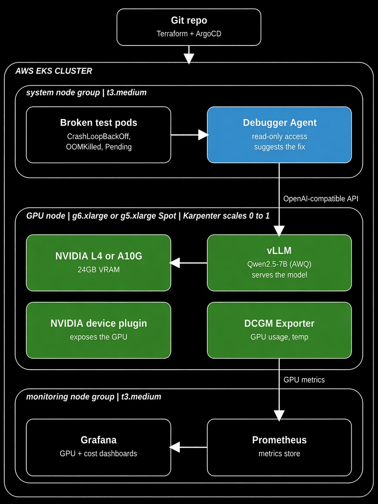

# Debugger Agent

A self-hosted model on a Spot GPU diagnoses six deliberately broken pods. The Debugger Agent can read those pods and nothing else. The GPU exists only while a Git commit says `replicas: 1`.



Git holds Terraform and the Argo CD apps. Terraform builds the EKS cluster. Argo CD, running on the system node, applies the apps back onto the cluster. Karpenter creates the Spot GPU node when vLLM cannot schedule, and removes it after the pod is gone.

## What runs where

- **System node group**, one `t3.medium`: CoreDNS, Karpenter, Argo CD, the Debugger Agent, and the six broken pods. A ResourceQuota of 1 CPU and 512Mi keeps the lab from crowding the node.
- **Monitoring node group**, one `t3.medium`, tainted `workload=monitoring:NoSchedule`: Prometheus and Grafana. Broken pods cannot land here.
- **GPU node**, Spot `g6.xlarge` or `g5.xlarge`, scaled from 0 to 1 by Karpenter: vLLM serving `Qwen/Qwen2.5-7B-Instruct-AWQ`, the NVIDIA device plugin, and the DCGM exporter. The EKS accelerated image already contains the driver and the container toolkit. There is no GPU Operator.

The agent source is `agent/diagnose.py`. The running Job uses a container image built from that file, pushed to ECR. The ServiceAccount `debugger-agent` is what makes it read-only. The image does not grant permissions.

## Cost of a session

Prices are us-east-1 list prices from November 2026. Spot moves during the day.

Left up all month, with the GPU off, the floor is about $144: $73 for the EKS control plane, $61 for two `t3.medium` nodes, $7 for their public IPv4 addresses, and $3 for the disks. A GPU node is extra only while `replicas` is 1. On demand, a `g6.xlarge` is $0.805 an hour. An hour-long take on Spot is on the order of a dollar.

Bring the cluster up the day you work, and destroy it the same day.

```bash
make up          # terraform apply. Give it about twenty minutes.
make kubeconfig  # the API address is new after every apply
make down        # terraform destroy. Wait until it finishes.
```

`make pause` scales both node groups to zero when you need the same cluster tomorrow. The control plane keeps billing at $0.10 an hour, about $2.40 a day. `make down` stops every charge, including the control plane. Terraform state stays in `terraform/terraform.tfstate` on the machine that ran apply. That file is what makes the next destroy work, and it is not committed.

The ECR repository is part of Terraform, so `make down` deletes the image. The next session needs `make image-push` again. The vLLM weights also download again the first time the GPU comes up.

Set `budget_email` so a forgotten cluster sends mail at 80% and 100% of $50. That budget is a tripwire for the whole account, not a forecast of a healthy month. At the floor it fires in under two weeks. With a GPU left on, it fires in a couple of days.

```bash
terraform -chdir=terraform apply -var budget_email=you@example.com
```

Two other costs are kept off on purpose. There is no NAT gateway and no load balancer. Grafana is a ClusterIP service, opened with `kubectl port-forward`. Control-plane logs, VPC flow logs, and Container Insights are off. The Kubernetes version is 1.36 with support type `STANDARD`. Version 1.34 leaves standard support on 2 December 2026 and would jump to $0.60 an hour. Do not pin it.

EKS still needs subnets in two availability zones for the control plane. Every node is pinned to the first zone, so pod traffic stays in one place.

## Before the first apply

- Spot G-instance quota of at least 4 vCPU. New accounts often have none, and an increase can take days.
- A public Git repository. Argo CD syncs it with no credentials. Pass the URL as `gitops_repo_url`. Until you do, the default `https://github.com/example/k8s-debug-demo.git` will not sync.
- AWS credentials for Terraform, and the AWS CLI for kubeconfig and the image push.
- Docker, for `make image-push`.

## Run a diagnosis

```bash
export TF_VAR_gitops_repo_url=https://github.com/YOU/YOUR-REPO.git
make up
make kubeconfig
make image-push
```

`make image-push` writes the ECR URL into [cluster/kustomization.yaml](cluster/kustomization.yaml). Commit and push that change so Argo CD rolls the CronJob onto the image you built.

Wake the GPU by setting `replicas: 1` in [cluster/vllm.yaml](cluster/vllm.yaml) and pushing the commit. Karpenter adds the Spot node. The model download happens on that boot. `/health` stays failed until the weights are loaded, which can take several minutes.

```bash
kubectl -n llm get pods -w
kubectl -n debugger create job debug-once --from=cronjob/debugger-agent
kubectl -n debugger logs job/debug-once -f
```

Each line is one pod: category, root cause, evidence, a proposed fix, and the cost of that call. `kubectl logs job/debug-once | python3 agent/diagnose.py costs` sums the receipt. The GPU keeps billing until you set `replicas` back to 0 and push.

```bash
kubectl -n monitoring port-forward svc/monitoring-grafana 3000:80
```

Grafana user `admin`, password `demo`. The Debugger Agent dashboard shows tokens, GPU dollars per hour while the node is up, GPU utilization, and lab restarts. Prometheus keeps one day of data in memory. A restart forgets it.

Score a saved log against the answers. The answer file stays on your machine. It is not in the cluster and not in the image.

```bash
kubectl -n debugger logs job/debug-once > /tmp/debug.jsonl
python3 agent/diagnose.py eval /tmp/debug.jsonl
```

Deleting the RoleBinding in [cluster/rbac.yaml](cluster/rbac.yaml) and pushing that commit is the kill switch. Argo CD removes it from the cluster.

## Layout

- [terraform/](terraform/) builds the VPC, EKS, both node groups, Karpenter, the device plugin, Argo CD, ECR, and the budget.
- [cluster/](cluster/) is what Argo CD syncs: the GPU NodePool, vLLM, the DCGM exporter, the lab, the Debugger Agent, PodMonitors, and one Grafana dashboard.
- [agent/diagnose.py](agent/diagnose.py) is the agent. [agent/expected.yaml](agent/expected.yaml) is the score sheet.

The six failures in `k8s-lab` are a crash loop that prints a fake API key, an OOM past a 32Mi limit, a missing image tag, a missing ConfigMap key, a liveness probe on the wrong port, and a PVC whose StorageClass does not exist.

## Checks

```bash
make test       # redactor and score
make validate   # terraform fmt, terraform validate, kustomize build
```

`terraform apply`, a Spot GPU, and a live diagnosis need your AWS account. This repository cannot run those from here.

## Later

The Debugger Agent stays read-only. A later version can file a ticket, and a separate agent, with its own image and ServiceAccount, can take that ticket when the severity matches what its permissions are allowed to fix. The path recorded for those agents is wider read access, then an agent that can change pods under guardrails, then an agent that opens a Git pull request.

Still deferred: a chaos node pool, an admission policy, KEDA, the GPU Operator, private subnets, Alertmanager, and a disk for Prometheus.
